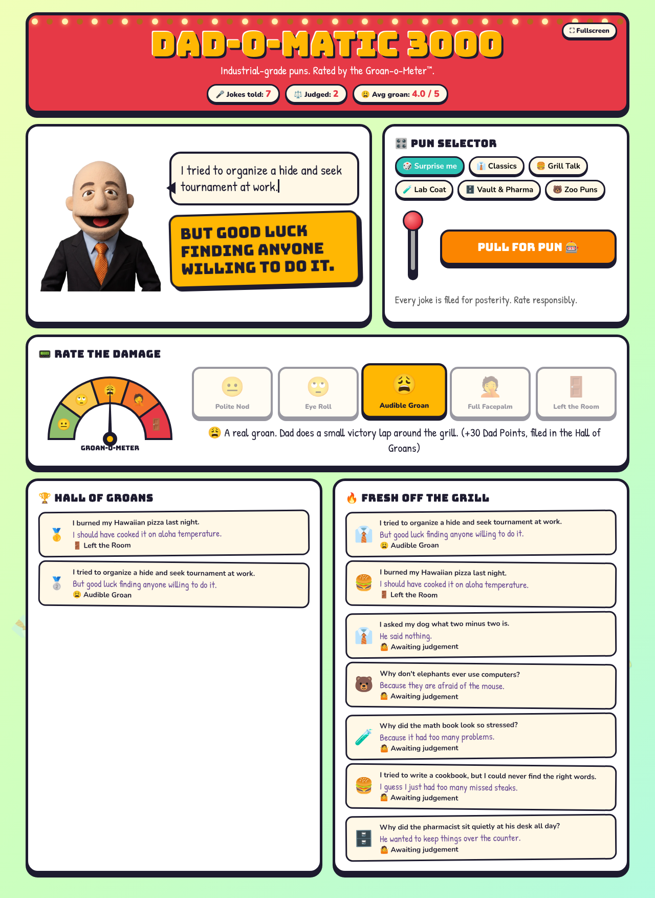

# Dad-O-Matic 3000 🎰👔

A Veeva Vault **Custom Page** that generates dad jokes, stores every joke it tells as a Vault record, and lets you rate each one on the **Groan-o-Meter™**.



## What it does

- **Pull the lever.** Dad, a felt puppet, flaps his mouth while the setup types out, then waits. Press **Hit me with it!** and the punchline slams in with a *BA-DUM-TSS!* and emoji confetti while Dad laughs. He blinks every few seconds.
- **Pick a category.** Classics, Grill Talk, Lab Coat, Vault & Pharma, Zoo Puns, or Surprise me. Jokes already told aren't repeated until a category runs dry.
- **Rate the damage.** In dad-joke land, the more it hurts the better:

  | Score | Groan level | |
  |---|---|---|
  | 1 | 😐 Polite Nod | Dad is concerned. |
  | 2 | 🙄 Eye Roll | The dad engine is warming up. |
  | 3 | 😩 Audible Groan | Small victory lap around the grill. |
  | 4 | 🤦 Full Facepalm | LinkedIn updated: "Professional Punsmith". |
  | 5 | 🚪 Left the Room | The highest honour a dad can receive. |

  The gauge needle swings and you earn Dad Points.
- **Fullscreen.** The ⛶ button in the header takes the page fullscreen (or fills the browser window if Vault blocks fullscreen). Esc exits.
- **Hall of Groans** shows the top-rated jokes; **Fresh Off the Grill** shows the latest ones. The header tracks jokes told, jokes judged and the average groan.

## How it's built

There is no server code. The page is client code only, and it reads and writes Vault through `vaultApiClient` from the Vault Web SDK, so it runs with the viewing user's own permissions.

| Path | What |
|---|---|
| `mdl/dad_jokes.mdl` | `groan_level__c` picklist, `dad_joke__c` object, `dad_joke_generator__c` page, `dad_jokes__c` tab |
| `client/src/index.js` | The page (`definePage`), built with plain DOM, no framework |
| `client/src/jokes.js` | Joke library, categories and the Groan-o-Meter levels |
| `client/src/vault.js` | Vault API calls: create the joke, record the rating, VQL for the lists and stats |
| `client/src/dad.js` | Dad: four stacked photo frames (rest, talk, grin, blink) swapped by CSS |
| `client/assets/` | The four Dad frames as transparent WebPs, inlined into the bundle |
| `scripts/cutout.py` | Turns new Dad photos into those WebPs (keys out the background, resizes to 600px wide) |
| `preview/index.html` | Local preview with a fake in-memory Vault API |

### The `dad_joke__c` object

| Field | Type | Notes |
|---|---|---|
| `name__v` | Text | Setup, truncated to 120 chars |
| `joke_setup__c` | Text (1500) | |
| `joke_punchline__c` | Text (1500) | |
| `joke_category__c` | Text (50) | `classic`, `food`, `science`, `vault`, `animals` |
| `groan_level__c` | Picklist `groan_level__c` | Empty until rated |
| `groan_score__c` | Number 0–5 | Empty until rated; used for sorting and the average |

Each joke is created as soon as it's told and updated with its rating when someone rates it, so unrated jokes are kept too.

## Deploy

Requires Node 18+ and a user with Admin and code permissions (deploying client code needs the *Vault Owner* profile or equivalent).

```sh
VAULT_HOST=myvault.veevavault.com VAULT_SESSION=<session id> ./scripts/deploy.sh
```

The script builds and zips the client code, uploads the `dad_jokes__c` distribution, then runs the MDL. Open the page at `https://<host>/ui/#custom/page/dad-jokes` or from the **Dad Jokes** tab.

Users other than Vault Owners need a permission set with **View** on the *Dad Joke Generator* page and *Dad Jokes* tab, and **Read/Create/Edit** on the *Dad Joke* object.

## Develop

```sh
cd client
npm ci
npm run build                     # bundles to client/dist
cd .. && python3 -m http.server   # then open http://localhost:8000/preview/
```

The preview stands in for Vault with an in-memory `dad_joke__c` table, so you can pull the lever without touching a Vault.

### Replacing Dad

Supply four photos that are identical apart from the face: rest (mouth closed), talk (mouth part open), grin (big laugh) and blink (eyes closed), same size and framing. Then:

```sh
pip install numpy pillow scipy
python3 scripts/cutout.py rest.jpg talk.jpg grin.jpg blink.jpg   # writes client/assets/*.webp
```

The script expects a light, neutral background (white, light grey or a checkerboard).
